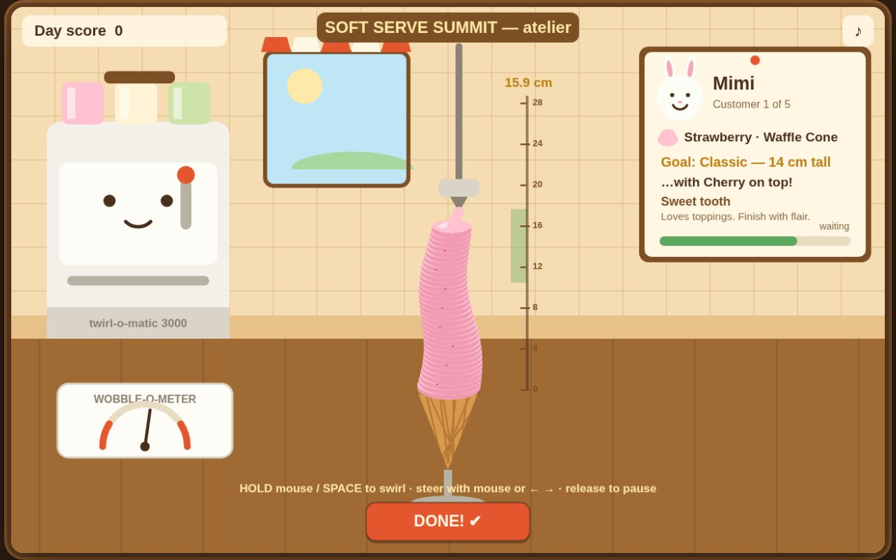

# Soft Serve Summit

**How tall can you swirl?** An original soft-serve atelier game for the
browser: hold to swirl, steer to keep the tower standing, and plate up
points for height, balance and even swirls.



## The game

Five customers visit your little soft serve atelier. Each hands you an
order ticket — a flavour, a cone, a height to aim for, a topping they
dream of, and a trait that bends the judging — and watches the waiting
gauge while you work.

- **Hold** the mouse (or touch, or SPACE) and the serve grows.
- **Steer** with the mouse or the arrow keys: the taller the tower, the
  harder it sways, and a leaning tower topples.
- **Let go** to pause and breathe; press **DONE!** when it stands right.
- **Finish** with up to two toppings — match the ticket's request — and
  ring the bell.

Every serve is graded like a judge's card: height, balance, evenness of
the swirls, how well it matches the order, and a little flair. Grades run
C to S. Run out of waiting time and the customer simply leaves — the day
goes on.

## Play it

```sh
node serve.ts
# open http://localhost:8080
```

The game is plain static files under `game/` — no build step, no network.
Sounds and music are synthesised with WebAudio; the art is drawn in
canvas. Everything is original.

## Layout

- `main.ts` — the hand-in program: copies `game/` and `screenshots/` to
  the output directory and writes `dossier.json` via
  `vendor/makefun-game.ts` (the make.fun kit library, unchanged).
- `game/src/` — one file per job: `tower.js` grows and topples the stack,
  `score.js` grades it, `game.js` runs the day, `render.js` draws it,
  `input.js` steers it, `menu.js` is the menu board, `shots.js` stages
  the screenshots.
- `screenshots/` — four renders of the game itself, taken by its maker.

## License

MIT — see `LICENSE`.
